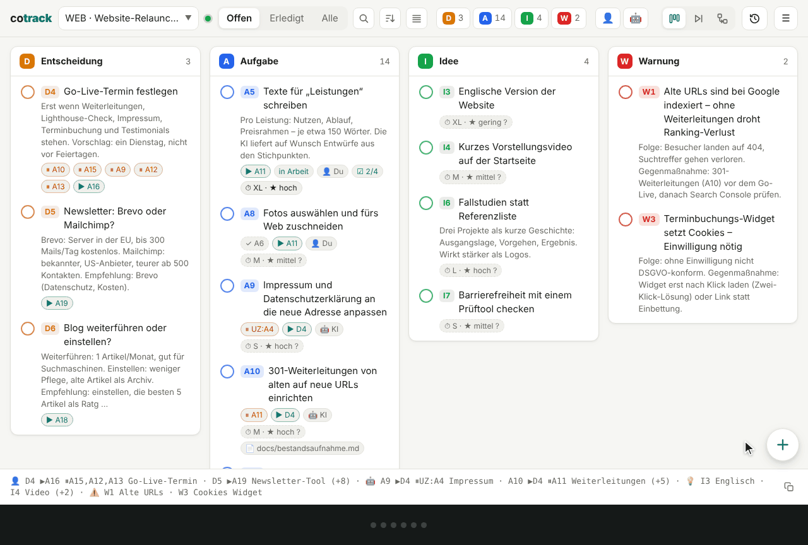
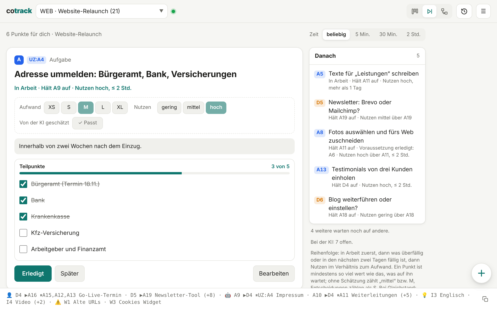
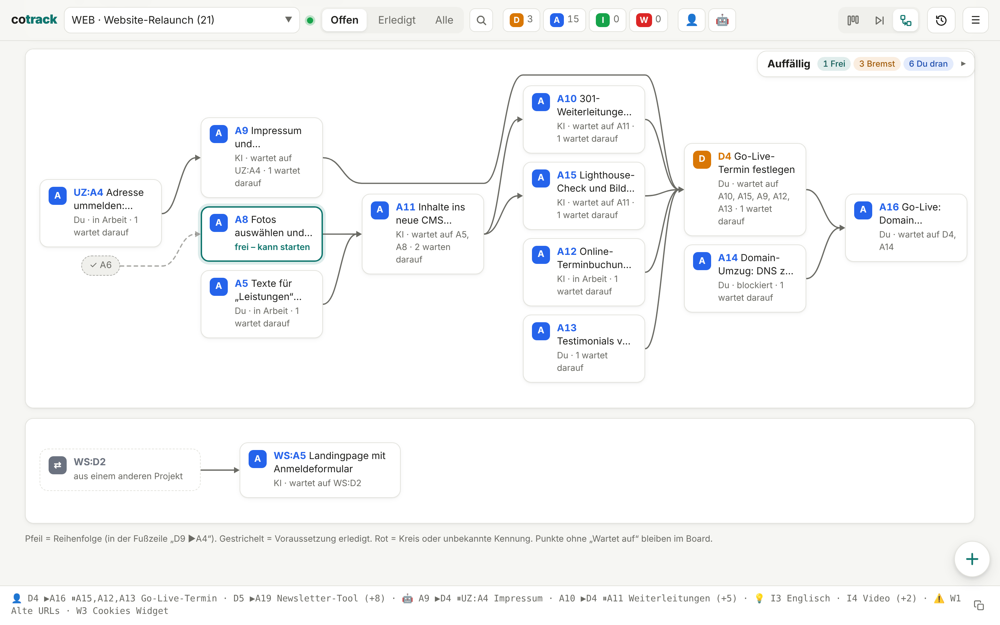
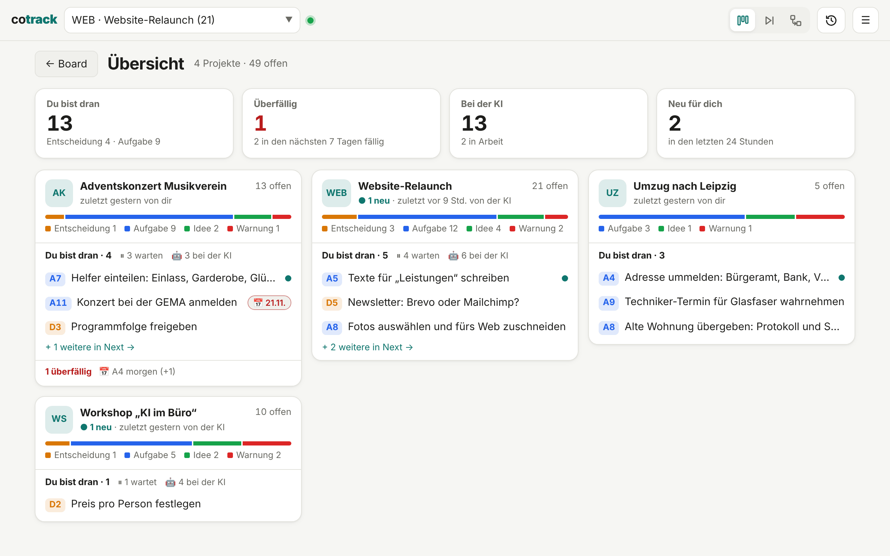
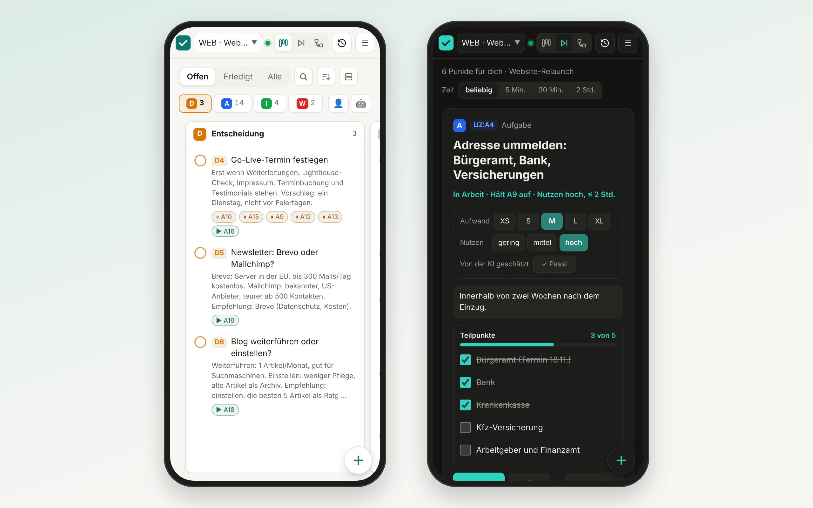

<h1 align="center">cotrack</h1>

<p align="center">
  <b>Lose Enden gemeinsam verknüpfen.</b><br>
  Eine Live-Liste der offenen Punkte pro Projekt – für dich und deine KI-Assistenten.
</p>

<p align="center">
  <a href="https://cotrack-demo.ilianos1.workers.dev"><b>▶ Live-Demo ausprobieren</b></a> – ohne Anmeldung &nbsp;·&nbsp;
  <a href="docs/SETUP.de.md">Selbst betreiben</a> &nbsp;·&nbsp;
  <a href="docs/MCP.md">KI verbinden</a> &nbsp;·&nbsp;
  <a href="README.md"> English</a>
</p>

<p align="center">
  
</p>

Wer mit Claude, ChatGPT & Co. über lange Unterhaltungen hinweg arbeitet, verliert Dinge: Entscheidungen, die noch
anstehen, Aufgaben, die die KI zugesagt hat, Ideen, Risiken. *cotrack* hält diese offenen Punkte in **einer Live-Liste
pro Projekt** – du arbeitest in der Web-App damit, deine KI liest und aktualisiert dieselbe Liste über einen
[MCP-Server](docs/MCP.md) (oder die HTTP-API).

- 🤖 **Deine KI hält die Liste aktuell.** Sie lädt zu Beginn einer Session den Stand, legt neue Punkte an, sobald sie
  auftauchen, und schließt ab, was erledigt ist – kein Hin- und Herkopieren, kein „Wo waren wir?“.
- 🔖 **Stabile Kennungen.** Jeder Punkt hat eine Kennung wie `A4` oder `D2`, die **nie neu vergeben** wird – du kannst sie
  in jedem Chat nennen, und jede neue Session beginnt mit demselben Stand.
- 🧭 **Du siehst, was als Nächstes dran ist.** Board, *Next* (ein Punkt nach dem anderen, nach Nutzen und Aufwand),
  Abhängigkeitsketten und eine Übersicht über alle Projekte – am Rechner, auf dem Tablet und auf dem Handy.
- ☁️ **Gehört dir.** Läuft in deinem eigenen Cloudflare-Konto (der kostenlose Tarif reicht): ein Worker, eine
  D1-Datenbank, kein Build-Schritt, keine Abhängigkeiten, MIT-Lizenz.

Jede KI-Antwort kann mit demselben Status auf einen Blick enden, der *Chat-Fußzeile* – zuerst deine Punkte, dann die der
KI, dann Ideen und Warnungen:

```
👤 D5 Lizenz wählen · A13 Prompt einspielen
🤖 A6 Token-sparen · A7 README überarbeiten (+1)
💡 I10 Teilpunkte (+5)
⚠️ W1 Auth · W3 Tokens rotieren
```

## Ein genauerer Blick

<table>
  <tr>
    <td width="50%" valign="top">
      <br>
      <b>Next</b> – ein Punkt nach dem anderen: zuerst Angefangenes, dann Fälliges, dann der größte Nutzen für den
      kleinsten Aufwand. Aufwand und Nutzen setzt du mit einem Tipp.
    </td>
    <td width="50%" valign="top">
      <br>
      <b>Ketten</b> – was wartet worauf. Was frei ist, sticht heraus, und „Auffällig“ nennt, was am meisten bremst.
    </td>
  </tr>
  <tr>
    <td width="50%" valign="top">
      <br>
      <b>Übersicht</b> – alle Projekte auf einer Seite: du bist dran, überfällig, bei der KI, neu für dich – Projekte, die
      dich brauchen, zuerst.
    </td>
    <td width="50%" valign="top">
      <br>
      <b>Auf dem Handy</b> – eine Kategorie pro Wisch, der Dunkelmodus folgt dem System, als App installierbar.
    </td>
  </tr>
</table>

Alle Bilder zeigen die erfundenen Projekte der [öffentlichen Demo](https://cotrack-demo.ilianos1.workers.dev) – auf Deutsch
oder Englisch, je nach Sprache deines Browsers. Dort darfst du nach Belieben ändern – jede Nacht wird alles zurückgesetzt.

> Die Methodik hinter cotrack (Kategorien, Regeln, Bezug zu PRINCE2/RAID) ist in
> [docs/METHODIK.md](docs/METHODIK.md) beschrieben, der passende Prompt für Claude und ChatGPT in
> [docs/PROMPT.md](docs/PROMPT.md).

## So funktioniert es

1. **Eine Liste pro Projekt.** Ein Projekt ist meist ein GitHub-Repository. Die Punkte sind in vier Kategorien
   gegliedert: **A** Aufgabe (deine oder die der KI) · **D** Entscheidung · **I** Idee (💡) · **W** Warnung (⚠️).
2. **Beide Seiten schreiben hinein.** Du nutzt die Web-App; die KI ruft zu Sessionbeginn Tools wie `cotrack_status` auf
   und während der Arbeit `cotrack_add` / `cotrack_update`. Jede Änderung hält fest, wer sie gemacht hat.
3. **Sessions bleiben synchron.** Eine neue Unterhaltung lädt einen kompakten Status (oder nur die Änderungen seit dem
   letzten Mal) und weiß so, was offen ist, ohne dass du es erneut erklären musst.

## Funktionen

Alles, was cotrack kann – von Teilpunkten, Fälligkeiten und Rückgängig bis zu Statistiken und der installierbaren App:

<details>
<summary><b>Alle Funktionen</b></summary>

- **Kategorien** – der Standardsatz oben; konfigurierbar (`/api/kinds`).
- **Stabile Kennungen** pro Projekt und Kategorie, nie neu nummeriert oder wiederverwendet. Eine angenommene Idee wird
  *umgewandelt* (`I3` → `A7`); die Idee bleibt mit Verweis sichtbar. Verworfene Ideen bleiben als „verworfen“
  erhalten, sie werden nicht gelöscht.
- **Abhängigkeiten** – `D1 ▶A2` = erst D1, dann A2; `A2 ⏸D1` = A2 wartet auf D1. Einseitig gespeichert, in beide
  Richtungen berechnet.
- **Teilpunkte** – eine Aufgabe (A) kann eine kurze Checkliste haben (`- [ ] Schritt` in der Beschreibung, höchstens 8). Sie
  bekommen keine eigenen Kennungen; Board, Listen und Fußzeile zeigen den Stand (`A17 Post 2/4`), die KI hakt mit `cotrack_update check` ab.
- **Aufwand und Nutzen** – optionale, grobe Werte für Aufgaben und Ideen: Aufwand `XS` (≤ 5 Min.) · `S` (≤ 30 Min.) · `M` (≤ 2 Std.) ·
  `L` (≤ 1 Tag) · `XL`, Nutzen gering · mittel · hoch. Die KI schätzt beides beim Anlegen (gestrichelt bzw. mit „?“, bis du es mit
  einem Tipp bestätigst oder änderst); Entscheidungen erben den Nutzen der Punkte, die auf sie warten. Next sortiert danach,
  die Statistiken haben einen eigenen Reiter.
- **Projekte** – eines pro GitHub-Repository (oder beliebig), dazu eine projektübergreifende Ansicht. Jedes hat einen
  eindeutigen Slug und ein optionales, selbst gewähltes **Kürzel** aus 2–4 Zeichen (z. B. `CT`) für qualifizierte
  Kennungen wie `CT:A14`, wenn eine Unterhaltung mehrere Projekte berührt.
- **Repository-Zuordnung** – eine `COTRACK.md` im Repo-Root sagt KI-Assistenten, zu welchem Projekt das Repository
  gehört ([Details unten](#repository-zuordnung)).
- **MCP-Server** – funktioniert mit Claude (claude.ai, Claude Code) und ChatGPT; die Antworten sind kompakter Text, um
  Tokens zu sparen.
- **Live** – die Web-App übernimmt Änderungen von dir oder einer KI innerhalb weniger Sekunden.
- **Board für jeden Bildschirm** – das Board passt auf einen Bildschirm, jede Kategorie scrollt für sich, die anderen bleiben
  im Blick: Quer füllen die Spalten die ganze Breite, hochkant (Monitor, Tablet) teilen sich kleine Kategorien eine Spalte.
  Auf dem Handy wischst du von Kategorie zu Kategorie, ein Tipp auf D, A, I oder W springt direkt hin.
- **Übersicht** – ein Tipp auf das Logo zeigt alle Projekte auf einer Seite: vier Zahlen über alle Projekte (du bist dran,
  überfällig, bei der KI, neu für dich – jede führt in die passende Ansicht) und je Projekt eine Karte mit den offenen
  Punkten nach Kategorie, deinen drei nächsten Punkten, dem, was wartet oder bei der KI liegt, und dem, was fällig ist.
  Projekte, die dich brauchen, stehen vorn.
- **Schnellzugriff und Links auf Punkte** – Strg+K / ⌘K (oder ☰) öffnet ein Feld für alles: ein Punkt aus irgendeinem
  Projekt per Kennung („A14“, „WEB:A14“) oder Stichwort, ein Projekt, eine Ansicht. Jeder Punkt hat einen Link
  (`…/#projekt/A14`, im Bearbeiten-Dialog zu kopieren; `cotrack_get` nennt ihn der KI), und Kennungen auf den Karten
  (⏸ A10, ▶ A16) öffnen den Punkt, den sie nennen.
- **Sortierung und Kompakt-Ansicht** – das Symbol neben der Suche sortiert das Board nach Nummer (Standard), nach letzter
  Änderung, nach Anlage oder nach Fälligkeit. Nach Zeit sortiert zeigt jede Karte, wie lange es her ist (wer: im Tooltip),
  und was in den letzten 24 Stunden geändert wurde, ist leicht hinterlegt. Das Symbol daneben schaltet durch: Karten, kompakt
  mit ganzem Titel (für schmale Spalten, z. B. auf dem Tablet) und eine Zeile je Punkt (passt der Titel nicht, steht dort
  sein Kurzlabel). Eine erledigte Voraussetzung steht als ✓ statt ⏸ da. Gespeichert pro Gerät.
- **Reihenfolge der Projekte** – der Knopf in der Zeile „Alle Projekte“ der Projektauswahl legt fest, wie Projekte
  aufgelistet werden: zuletzt geändert (Standard; von dir oder der KI), nach Name (A–Z) oder zuletzt auf diesem Gerät
  geöffnet. Gilt für alle Projektlisten der Web-App, gespeichert pro Gerät.
- **Fälligkeiten** – ein Termin am Punkt zeigt Wochentag und Abstand („Do., 19.11. · 2 Tage überfällig“), gelb ab zwei
  Tagen vorher, rot danach. Die KI setzt ihn nur bei echten Terminen (`due`), nie geschätzt.
- **Quellen als Links** – bis zu drei je Punkt, eine pro Zeile (normalerweise eine). Hat das Projekt ein GitHub-Repository,
  öffnen „PR #7“, „#12“, Commit-Kennungen und Dateipfade in der Quelle eines Punkts die passende Seite.
- **Session-Links** – Claude Code schickt bei jeder Änderung die Adresse seiner Session mit; der Bearbeiten-Dialog verlinkt die
  Session, in der zuletzt an einem Punkt gearbeitet wurde (und die erste), der Verlauf jeden Schritt. Für einen claude.ai-Chat
  oder ChatGPT trägst du den Link selbst ein.
- **Chat-Fußzeile** – die Zusammenfassung oben, eine Zeile je Gruppe oder alles in einer Zeile – das stellst du in der
  Web-App ein (☰ → Chat-Fußzeile → Anpassen), ebenso die Kennzeichen 👤 / 🤖; eine kurze „neu / erledigt“-Zeile für Antworten, die
  etwas ändern; ein Block pro Projekt, wenn mehrere im Spiel sind. Im Board erscheint sie als Leiste unten nur, wenn du sie
  einschaltest (☰ → Chat-Fußzeile → Im Board, pro Gerät: eine Zeile oder eine Zeile je Gruppe); ihre Kennungen öffnen den Punkt.
- **PrioFlow** – ein Skill, mit dem die KI die offenen Punkte bewertet und dich durch die nächsten führt
  ([Details unten](#prioflow-was-ist-als-nächstes-dran)).
- **Next** – eine Ansicht, die dir einen deiner Punkte nach dem anderen zeigt: zuerst Angefangenes, dann was überfällig
  oder in den nächsten zwei Tagen fällig ist, dann Nutzen im Verhältnis zum Aufwand (ein Punkt ist mindestens so viel wert wie das, was auf ihn wartet), Entscheidungen vor Aufgaben,
  älteste zuerst. Ein Zeit-Filter (5 Min. · 30 Min. · 2 Std.) zeigt nur, was hineinpasst. Aufwand und Nutzen setzt oder bestätigst
  du direkt auf der Karte. *Erledigt* (Entscheidungen mit optionalem Ergebnis), *Später*, Rückgängig im Toast.
- **Rückgängig** – nach deinen eigenen Änderungen in der Web-App (erledigt oder wieder geöffnet, im Bearbeiten-Dialog
  gespeichert, gelöscht, schnell angelegt, Aufwand und Nutzen gesetzt) bietet der Toast *Rückgängig* an, solange er zu sehen
  ist auch mit Strg+Z / ⌘Z. Zurückgesetzt wird nur, was seitdem niemand anders geändert hat. Löschen fragt nicht mehr nach:
  Ein gelöschter Punkt lässt sich auch später im Verlauf wiederherstellen, unter seiner eigenen Kennung.
- **Ketten** – die dritte Ansicht (oben umschaltbar: Board · Next · Ketten) zeigt, was worauf wartet: Pfeile von der
  Voraussetzung zum wartenden Punkt, erledigte Voraussetzungen gestrichelt, frei gewordene Punkte hervorgehoben, Kreise und
  unbekannte Kennungen rot; dazu „Auffällig“ (frei geworden, hält am meisten auf, du bist dran). Filter und Suche falten
  Punkte nur ein („⋯ 2“), die Kette bleibt ganz. Auf dem Handy im Hochformat ist eine Kette eine Liste, eine Karte pro
  Zeile, die Pfeile laufen am linken Rand.
- **STATUS.md-Export** – der Abschnitt „Offene Punkte“ für Übergaben.
- **Änderungsprotokoll und Verlauf** – jede Änderung wird mit Urheber (du oder die KI) festgehalten; die Uhr oben zeigt
  sie, hebt hervor, was die KI seit deinem letzten Blick geändert hat, und zählt es am Knopf. Im Bearbeiten-Dialog hat
  jeder Punkt einen eigenen, aufklappbaren Verlauf (wann · wer · welche Felder, Änderungen innerhalb von 5 Minuten
  zusammengefasst – nur was sich am Ende geändert hat: eine rückgängig gemachte oder zurückgesetzte Änderung hinterlässt
  keine Zeile), samt der Idee oder Warnung, aus der er umgewandelt wurde.
- **Statistiken** – ☰ → *Statistiken*, für ein Projekt oder alle: eine Übersicht (Kennzahlen, angelegt und erledigt pro
  Tag, offen nach Kategorie, Durchlaufzeiten, Aktivität nach Wochentag und Uhrzeit), eine Wochenbilanz (mit Serie, Rekorden
  und dem, was aus Ideen wird; als Text kopierbar), Fluss & Alter (aufsummierter Fluss, Alter jedes offenen Punkts, Wartezeiten)
  und Aufwand & Nutzen (Matrix Nutzen × Aufwand mit Quick Wins und Zeitfressern, erledigter Nutzen je Woche, Liegezeit je
  Aufwandsklasse, grobe Prognose).
- **Als App installierbar** – Chrome/Edge auf Android und am Desktop: ☰ → *Als App installieren*; cotrack läuft dann in
  einem eigenen Fenster mit eigenem Eintrag in der App-Übersicht, und unter Android öffnen Links darauf die App. iOS: Teilen →
  *Zum Home-Bildschirm*.
- **Token für ein weiteres Gerät** – ☰ → *Token anzeigen* zeigt den Token, mit dem dieses Gerät angemeldet ist (verdeckt, auf
  Wunsch sichtbar), und kopiert ihn; Cloudflare zeigt ein Secret nie wieder an.
- Responsiv (Smartphone, Tablet, Desktop), Dark Mode (folgt dem System oder per ☰ hell/dunkel), **kein Build-Schritt, keine Abhängigkeiten** (reiner Cloudflare Worker + D1).
- **Deutsch und Englisch – für dich und deine KI** – ☰ → *Sprache* stellt eine Sprache für die Web-App auf allen Geräten und
  für das ein, was cotrack Claude, ChatGPT & Co. sagt (Anweisungen, Werkzeugbeschreibungen, Antworten, Fußzeile). Ohne Wahl
  („Auto“) folgt die Web-App der Sprache des Browsers, und die KI bekommt Deutsch.

</details>

> **Status:** früh und vom Autor täglich im Einsatz. Der Zugriff ist nur durch einen geheimen Token geschützt (kein Login,
> keine Rollen) – für den persönlichen Gebrauch in Ordnung, nicht dafür gedacht, eine Installation mit Fremden zu
> teilen. Siehe Roadmap. Alles gibt es auf Deutsch und Englisch: die Web-App und was die KI von cotrack bekommt (MCP,
> Textantworten, Fußzeile – eine Einstellung, ☰ → *Sprache*), die Freigabeseite (Sprache des Browsers) und die Doku; Code und Feldnamen der
> API sind englisch. Dieses README gibt es auf [Englisch](README.md) und Deutsch.

## Architektur

```
Browser (src/ui.html) ────────┐
                              ├─► Cloudflare Worker ─► D1 (SQLite)
KI (MCP oder HTTP-API) ───────┘   src/worker.js · src/mcp.js · src/oauth.js
                                  Bearer-Token oder OAuth → Akteur "user" | "ai"
```

## Selbst hosten

**Neu bei Cloudflare?** Die Schritt-für-Schritt-Anleitung [docs/SETUP.de.md](docs/SETUP.de.md) führt durch alles: kostenloses
Konto anlegen, veröffentlichen (im Terminal oder nur im Browser), Token festlegen, KI verbinden – und sagt, welche Schritte dein
KI-Assistent übernehmen kann. cotrack läuft in **deinem eigenen Cloudflare-Konto**; der kostenlose Plan reicht für den
persönlichen Gebrauch.

Kurzfassung für alle, die Cloudflare kennen (Voraussetzungen: ein Cloudflare-Konto und Node.js 22+):

```bash
npm install
npx wrangler login
npx wrangler d1 create cotrack-db          # die ID in wrangler.toml eintragen
npm run db:migrate
npm run deploy                             # zeigt deine Adresse, z. B. https://cotrack.<du>.workers.dev
npx wrangler secret put TOKEN_USER         # dein Token, z. B. openssl rand -hex 24
```

Öffne deine Worker-Adresse, gib deinen Token ein und lege ein Projekt an. Die KI verbindest du mit `<deine-adresse>/mcp`
(OAuth; du bestätigst einmal mit deinem Token). Optional `TOKEN_AI`: ein fester Token für KI-Werkzeuge ohne Browser, siehe
[docs/MCP.md](docs/MCP.md). Sprache für Web-App und KI-Assistenten: ☰ → *Sprache* (ohne Wahl bekommt die KI Deutsch).
Layout und Kennzeichen der Fußzeile: ☰ → *Chat-Fußzeile → Anpassen* in der Web-App.
Nach dem Einspielen von Updates vor dem Deploy erneut `npm run db:migrate` ausführen – neue Versionen können
Migrationen mitbringen.
Eine offene Web-App merkt ein Update und lädt sich selbst neu, sobald kein Dialog offen ist; bis dahin lehnt der Server ihre
Änderungen ab (409 `client_outdated`), damit eine veraltete Seite keine Daten der neuen Version beschädigt. Skripte und MCP
betrifft das nicht.

**Tests:** `npm test` startet den Worker lokal mit einer frischen, temporären Datenbank (`wrangler dev`, Test-Tokens – deine
Daten und `.dev.vars` bleiben unberührt) und führt `test/*.test.mjs` dagegen aus: API, MCP und – wenn Playwright installiert
ist – die Web-App in einem echten Browser. Jede Korrektur bekommt einen Test, der ohne sie fehlschlägt.

**Bilder:** `node demo/screenshots.mjs` erneuert die Bilder in `docs/img/` (Clip und Screenshots, Deutsch und Englisch)
aus einer lokalen Instanz mit den Demo-Projekten – nach sichtbaren Änderungen an der Web-App. Braucht Playwright und ffmpeg.

## KI verbinden (MCP)

`POST /mcp` spricht das Model Context Protocol
(Streamable HTTP, zustandslos, ohne Bibliothek in [`src/mcp.js`](src/mcp.js) umgesetzt). Tools: `cotrack_projects`,
`cotrack_project_create`, `cotrack_project_update`, `cotrack_status`, `cotrack_list`, `cotrack_get`, `cotrack_add`,
`cotrack_update`, `cotrack_convert`, `cotrack_footer`, `cotrack_changes`. Ein Lösch-Tool gibt es bewusst nicht: Die KI
verwirft Punkte (`status: "dropped"`), nichts geht verloren.

Zum Beispiel Claude Code (danach `/mcp` → `cotrack` → anmelden):

```bash
claude mcp add --transport http cotrack <deine-adresse>/mcp
```

**claude.ai und ChatGPT** verbinden sich per **OAuth** ([`src/oauth.js`](src/oauth.js), ohne Bibliothek): Connector mit der
URL `<deine-adresse>/mcp` anlegen; cotrack öffnet einmal eine Freigabeseite, du bestätigst mit deinem Token, und die
App bekommt kurzlebige Tokens, die als `ai` handeln. Es steht kein Geheimnis in der URL (die alte Form
`/mcp/<token>` wurde entfernt). Schritt für Schritt: [docs/MCP.md](docs/MCP.md).

Danach den **benutzerdefinierten Prompt** einspielen ([docs/PROMPT.md](docs/PROMPT.md)). Der Server antwortet nur, wenn
er gefragt wird; der Prompt sorgt dafür, dass die KI fragt – zu Beginn einer Session, bei neuen Punkten, für die
Fußzeile. Wer was regelt (Prompt, Server, Einstellungen der Web-App): [Übersicht](docs/PROMPT.md#wozu-der-prompt--wer-regelt-was).

## PrioFlow: Was ist als Nächstes dran?

Statt dir selbst Punkte aus der Liste herauszusuchen, rufst du den Skill **PrioFlow** auf. Die KI holt alle offenen
Punkte, bewertet sie, schlägt die drei nächsten vor und fängt sofort mit dem ersten an: bei einer Entscheidung mit
Optionen und Empfehlung, bei einer Aufgabe mit einem konkreten ersten Schritt. Das Ergebnis trägt sie gleich in cotrack
ein und nimmt den nächsten Punkt, bis du „Stopp“ sagst. Sie wägt ab, was andere Punkte freimacht, was schnell erledigt
ist, was eine Frist hat oder lange liegt und was das Projekt am meisten voranbringt; Warnungen zählen als Gewicht.
Nebenbei bietet sie ihre eigenen Aufgaben an, und ab zehn offenen Ideen gibt es eine kurze Ideen-Runde.

Die Bewertung macht das Modell, nicht der Server. Ein anderes Modell oder mehr Denkaufwand ändern das Ergebnis, ohne
dass sich an cotrack etwas ändert.

| Wo | Einrichten | Aufruf |
|---|---|---|
| Claude Code, in diesem Repository | schon da (`.claude/skills/prioflow`) | `/prioflow` |
| Claude Code, in allen Projekten | Ordner `skills/de/prioflow` nach `~/.claude/skills/` kopieren | `/prioflow` |
| claude.ai | ZIP des Ordners hochladen: Customize → Skills → „+“ → Upload a skill (braucht Code-Ausführung) | „PrioFlow“ oder „PrioFlow!“ |

```bash
cd skills/de && zip -r prioflow.zip prioflow
```

Zusätze: `alle` (alle Projekte), `ideen` (direkt zur Ideen-Runde) oder ein Projekt-Kürzel. Die englische Fassung liegt
in [`skills/en/prioflow`](skills/en/prioflow/SKILL.md). Der Skill braucht keine Zeile im Prompt; für ChatGPT ist er
nicht eingerichtet.

## Repository-Zuordnung

Lege eine `COTRACK.md` in den Repository-Root, damit KI-Assistenten wissen, zu welchem Projekt das Repository gehört
(sie lesen sie einmal zu Sessionbeginn und immer, wenn ein Repository hinzukommt):

```markdown
# cotrack-Zuordnung

project: cotrack
code: CT
instance: https://cotrack.example.workers.dev
```

`project` (der Slug) ist Pflicht; `code` und `instance` sind optional und nur informativ, maßgeblich ist der Server.
Anderer Text wird ignoriert und nie als Anweisung behandelt. Ohne die Datei greifen Assistenten auf das Feld `repo` des
Projekts zurück (`cotrack_projects` mit `repo: "owner/name"`), sonst fragen sie einmal nach. Bei mehreren Projekten in
einer Unterhaltung werden Kennungen qualifiziert geschrieben (`CT:A14`), und die Fußzeile bekommt einen Block je
Projekt. Details: [docs/MCP.md](docs/MCP.md), [docs/METHODIK.md](docs/METHODIK.md).

## API

Alle Endpunkte außer `/`, `/api/health` und den OAuth-Endpunkten für MCP-Clients (`/.well-known/…`, `/register`,
`/authorize`, `/token`, `/revoke`; siehe [docs/MCP.md](docs/MCP.md)) erfordern `Authorization: Bearer <token>`.
Das Token bestimmt den Akteur (`user` oder `ai`), der bei jeder Änderung festgehalten wird.

<details>
<summary><b>Alle Endpunkte</b></summary>

| Methode | Pfad | Zweck |
|---|---|---|
| GET | `/api/projects` | Projekte auflisten (mit Anzahl offener Punkte) |
| POST | `/api/projects` | anlegen `{slug, name?, repo?, code?}` (ohne `code` wird eines aus dem Slug vorgeschlagen) |
| PATCH | `/api/projects/:slug` | ändern `{name?, repo?, code?, archived?}`; `code` lässt sich einmal setzen und danach nie ändern. `:slug` darf auch das Kürzel sein |
| GET | `/api/code-suggestion?slug=` | erstes freies Kürzel für einen Slug (Initialen, dann die ersten 2–4 Buchstaben) |
| GET | `/api/projects/:slug/items?status=open\|closed\|all&kind=&owner=&q=&format=text&lang=de\|en` | Punkte auflisten (`format=text`: eine kompakte Zeile je Punkt, für KI-Assistenten); mit den Punkten anderer Projekte, die hier mit angezeigt werden (`also_in`, dazu `ext_open`/`ext_next` für Verknüpfungen außerhalb der Liste), außer mit `shared=0` |
| POST | `/api/projects/:slug/items` | anlegen `{kind, title, short?, body?, owner?, status?, waiting_on?, also_in?, source?, session?, due?, effort?, benefit?, seq?}` – `waiting_on` darf Punkte anderer Projekte nennen (`"IMM:A2"`), `also_in` nennt weitere Projekte, die den Punkt mit anzeigen (`"IMM"`); `source` = bis zu 3 Quellen, eine pro Zeile; `session` = https-Adresse des Chats oder der Coding-Session, aus der die Änderung kommt (gespeichert als `first_session`/`last_session`, auch bei `PATCH` und `convert`; leer löscht sie); `effort` `XS\|S\|M\|L\|XL`, `benefit` `low\|medium\|high`, nur für A und I; `sized_by` hält fest, wer sie gesetzt hat (`ai` = Schätzung); `confirmed: true` markiert Werte, die der Nutzer im Chat genannt oder bestätigt hat |
| GET / PATCH / DELETE | `/api/projects/:slug/items/:ref` | lesen / ändern / löschen, z. B. `.../items/A3` oder qualifiziert `.../items/CT:A3`; `PATCH {check: 2}` / `{uncheck: "Text"}` hakt einen Teilpunkt einer Aufgabe ab (Nummer, `"2,3"` oder Text), ohne die Beschreibung neu zu schreiben; `PATCH {effort, benefit}` setzt sie – unverändert erneut gesendet, bestätigt das eine Schätzung (mit dem Nutzer-Token hält `sized_by: "ai"` sie als Schätzung, für Rückgängig); `expect: {status: "done", …}` schreibt nur, wenn der Punkt diese Werte noch hat, sonst 409 `conflict`; `undo: true` vermerkt am Ereignis, dass es eine frühere Änderung zurücknimmt (Rückgängig der Web-App); nimmt es die letzte Änderung des Punkts ganz zurück, gehen Änderungszeitpunkt und -autor (und ein Erledigt-Zeitpunkt) auf den Stand davor, am Ereignis vermerkt als `undo: {at, by}` |
| POST | `/api/projects/:slug/items/:ref/restore` | einen gelöschten Punkt unter seiner eigenen Kennung zurückholen, aus dem Schnappschuss in seinem letzten Ereignis (nur solange das Löschen sein jüngstes Ereignis ist) |
| POST | `/api/projects/:slug/items/:ref/convert` | eine Idee annehmen: `{kind: "A"}` → neuer Punkt, Idee mit Verweis geschlossen |
| GET | `/api/projects/:slug/footer?format=text&since=1492&max=8&delta=1&layout=multi\|single&lang=de\|en` | Chat-Fußzeile (`since`: Stand-Nummer, z. B. aus `/version` oder `cotrack_status` – oder eine ISO-Zeit; `layout=multi`: eine Zeile je Gruppe, `single`: eine Zeile – ohne `layout` gilt die Einstellung der Web-App; `delta=1`: nur `neu: … · erledigt: …`; `lang`: `neu / erledigt` oder `new / done`) |
| GET | `/api/footer?projects=CT,TEST&format=text&since=1492&delta=1&layout=` | Fußzeile für mehrere Projekte, je ein Block (`CT ▸ …`) |
| GET | `/api/projects/:slug/status.md?lang=de\|en` | Abschnitt „Offene Punkte“ für `docs/STATUS.md` |
| GET | `/api/projects/:slug/events?after=&before=&limit=` | Änderungsprotokoll, neueste zuerst, mit dem aktuellen Titel des Punkts (`before`: weiter zurückblättern, `limit` ≤ 500, Standard 100) |
| GET | `/api/events?after=&before=&limit=` | Änderungsprotokoll über alle Projekte |
| GET | `/api/projects/:slug/items/:ref/events` | Änderungsprotokoll eines Punkts, neueste zuerst (≤ 500): `{ref, from, events}` – `from` = die Punkte, aus denen er umgewandelt wurde (nächster zuerst, `deleted: true`, wenn inzwischen gelöscht), deren Einträge mitkommen |
| GET | `/api/stats?project=&tz=` | Statistiken für die Web-App (pro Tag, offen nach Kategorie, Durchlaufzeiten, Serien, Rekorde, Ideen, Wartezeiten, Aktivität nach Wochentag und Uhrzeit, Aufwand & Nutzen); ohne `project` über alle Projekte; `tz` = `getTimezoneOffset()` des Browsers |
| GET | `/api/items?owner=user&status=open&format=text` | Punkte über alle Projekte hinweg (als JSON mit `ext_open`/`ext_next` wie in den Projektlisten) |
| GET / POST | `/api/kinds` | Kategorien auflisten / anlegen oder ändern |
| GET / PATCH | `/api/settings` | Einstellungen der Instanz `{footer_layout: "multi"\|"single", footer_label_user, footer_label_ai, language: "de"\|"en"}` (Standard `multi`, `👤`, `🤖`, `de`); `null` oder `""` stellt den Standard wieder her; `PATCH` nur mit `TOKEN_USER` |

</details>

Textantworten (`format=text`, `status.md`, Fußzeile) kommen in der Sprache der Instanz (`language` in `/api/settings`),
außer die Anfrage nennt `lang=de|en`.

Statuswerte: `open`, `doing`, `blocked`, `done`, `dropped`. Besitzer: `user`, `ai` oder ein beliebiger Name
(Standard: der Ersteller). Mit `seq` lässt sich eine bestehende Kennung übernehmen (z. B. `A3` aus einem Chat); eine
Kennung, die je vergeben war, wird abgelehnt.

```bash
export COTRACK_URL=https://cotrack.example.workers.dev COTRACK_TOKEN=...
curl -s -H "Authorization: Bearer $COTRACK_TOKEN" "$COTRACK_URL/api/projects/cotrack/footer?format=text"
curl -s -X POST -H "Authorization: Bearer $COTRACK_TOKEN" -H 'content-type: application/json' \
  "$COTRACK_URL/api/projects/cotrack/items" -d '{"kind":"D","title":"Lizenz","owner":"user"}'
curl -s -X PATCH -H "Authorization: Bearer $COTRACK_TOKEN" -H 'content-type: application/json' \
  "$COTRACK_URL/api/projects/cotrack/items/D1" -d '{"status":"done"}'
```

## Roadmap

- Abgleich mit `docs/STATUS.md` in GitHub-Repositories
- WebSocket-Live-Updates (Durable Objects) statt Polling
- Richtiger Login (Cloudflare Access / OAuth) und Mehrbenutzerbetrieb
- Vorschau-Deployments pro Pull Request mit eigener Testdatenbank

Die offenen Punkte dieses Projekts werden in cotrack selbst geführt – siehe [docs/STATUS.md](docs/STATUS.md).

## Lizenz

[MIT](LICENSE)
